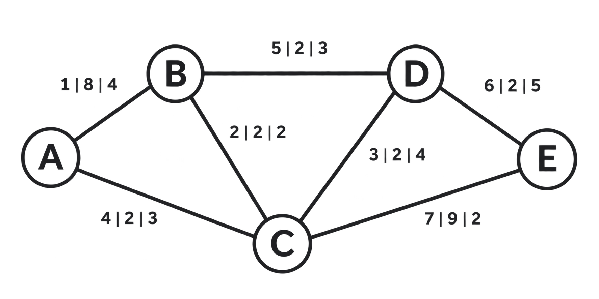

# Questão — Planejamento e operação de uma rede de comunicação

## Contexto

Uma prefeitura planeja uma rede de comunicação entre cinco unidades de atendimento, identificadas por A, B, C, D e E. A equipe deve analisar três demandas: interligar todas as unidades com o menor custo total de implantação, encontrar o percurso de menor tempo para uma mensagem de A até E e determinar a maior taxa total de transmissão de dados de A para E.

## Dados e condições

A tabela apresenta todas as ligações disponíveis. Cada ligação pode operar nos dois sentidos, com o mesmo tempo de transmissão e com a capacidade indicada disponível independentemente em cada sentido. O custo de implantação é pago uma única vez por ligação. Os tempos são fixos e aditivos ao longo de um percurso.

| Ligação | Custo de implantação (mil R$) | Tempo (ms) | Capacidade por sentido (Gbit/s) |
| --- | --- | --- | --- |
| A–B | 1 | 8 | 4 |
| A–C | 4 | 2 | 3 |
| B–C | 2 | 2 | 2 |
| B–D | 5 | 2 | 3 |
| C–D | 3 | 2 | 4 |
| C–E | 7 | 9 | 2 |
| D–E | 6 | 2 | 5 |

Na figura, os valores de cada ligação aparecem na ordem custo de implantação, tempo e capacidade por sentido, nas unidades da tabela.

Os três estudos são independentes: somente o primeiro seleciona quais ligações implantar. Nos estudos de tempo e de taxa de transmissão, todas as ligações da tabela estão disponíveis. No estudo da taxa, os dados podem ser distribuídos simultaneamente por diferentes caminhos. Nas unidades intermediárias, a taxa total de entrada deve ser igual à de saída, sem limite adicional de processamento nos vértices.

## Enunciado

Considerando as demandas e as condições apresentadas, avalie as afirmações a seguir.

**I.** Na implantação, as unidades são vértices e as ligações são arestas de um grafo não dirigido, com os custos como pesos. Kruskal ou Prim obtém a árvore {A–B, B–C, C–D, D–E}, que conecta as cinco unidades ao custo total mínimo de R$ 12 mil.

**II.** No estudo do tempo, uma busca em largura (BFS) iniciada em A, sem considerar os pesos, é suficiente para encontrar o percurso mais rápido até E. Nessa rede, minimizar o número de ligações também minimiza o tempo total de transmissão.

**III.** No estudo do tempo, as unidades são vértices e as ligações são arestas ponderadas pelos tempos de transmissão. Como esses pesos são positivos, Dijkstra é aplicável e obtém o percurso mínimo A–C–D–E, com tempo total de 6 ms.

**IV.** No estudo da taxa, cada ligação é representada por dois arcos de sentidos opostos, ambos com a capacidade indicada na tabela. Com A como fonte e E como sorvedouro, Ford–Fulkerson obtém a taxa total máxima de transmissão de 7 Gbit/s.

Assinale a alternativa que classifica corretamente as quatro afirmações.

- **A)** I e II são verdadeiras. III e IV são falsas.
- **B)** I e IV são verdadeiras. II e III são falsas.
- **C)** II e III são verdadeiras. I e IV são falsas.
- **D)** I, III e IV são verdadeiras. II é falsa.
- **E)** II, III e IV são verdadeiras. I é falsa.
